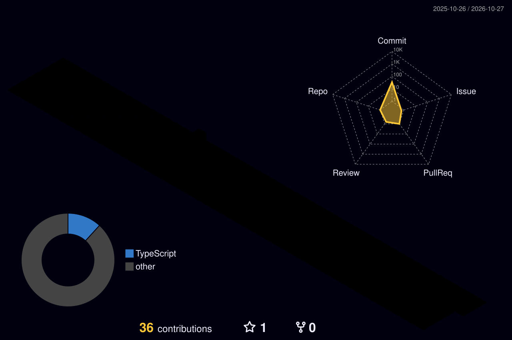

<!-- if you're reading the source, you're already my kind of person. -->

<div align="center">


<a href="https://tonieninja.dev"></a>

<br/>

[](https://tonieninja.dev)
[](https://tonieninja.dev/RustRenew/RustRenew.html)
[](https://discord.com/users/429324887048323073)
[](https://github.com/tonieninja)


</div>


<br/>

## 🥷 &nbsp;System Info

```text
┌──────────────────────────────────────────────────────────────┐
│  tonieninja@portfolio ~ $ neofetch                           │
├──────────────────────────────────────────────────────────────┤
│  👤 User       tonieninja                                    │
│  🛠️ Role       Full-Stack Developer & Creative Coder         │
│  🌍 Location   Poland 🇵🇱                                     │
│  🔨 Building   Rust Renew • tonieninja.dev                   │
│  🎮 Into       Game Tooling • Web Dev • Discord Bots • UI/UX │
│  🎨 Obsessed   Canvas, Web Audio, tiny details nobody asked  │
│  🥚 Secret     22 hidden themes in my portfolio              │
│  ⚡ Motto      ship fast, polish obsessively, hide eggs      │
└──────────────────────────────────────────────────────────────┘
```

<br/>

## 🧰 &nbsp;Tech Stack

<div align="center">


<br/>

<br/>


</div>

<br/>

## 🚀 &nbsp;Featured Projects

<div align="center">
<table>
<tr>
<td width="50%" valign="top">

### 🔧 &nbsp;Rust Renew
**The ultimate Rust companion suite**

Everything you need in one place, powered by the Rust+ API:

- 🏠 Real-time base management
- 💣 Raid calculators
- 🔨 Crafting tools
- 💡 Smart device controls
- 📡 Server monitoring

`JavaScript` `Firebase` `Rust+ API` `Canvas`

[](https://tonieninja.dev/RustRenew/RustRenew.html)


</td>
<td width="50%" valign="top">

### 🌐 &nbsp;tonieninja.dev
**A portfolio with 22 hidden themes**

Unlockable themes triggered by secret interactions:

- 🎮 Konami codes
- 🖱️ Mouse gestures
- ⌨️ Keyboard combos
- 🔊 Web Audio surprises
- 🎨 Canvas-powered effects

`JavaScript` `Tailwind CSS` `Canvas API` `Web Audio`

[](https://tonieninja.dev)


</td>
</tr>
</table>
</div>

<br/>

## 🏆 &nbsp;Trophies

<div align="center">


</div>

<br/>

## 📊 &nbsp;Stats

<div align="center">


<br/><br/>


</div>

<br/>

## 🧊 &nbsp;Contributions in 3D

<div align="center">



<br/><br/>


</div>

<br/>

## 🎯 &nbsp;Currently

| | |
|:--|:--|
| 🔨 **Building** | Rust Renew: more raid tools, smarter smart-device controls |
| 🎨 **Polishing** | tonieninja.dev: hunting for theme #23 |
| 📚 **Learning** | Rust, Unreal Engine 5 internals |
| 💬 **Ask me about** | Game tooling, Discord bots, canvas & web audio tricks |
| 🥚 **Fun fact** | I hide easter eggs in basically everything I make |

<br/>

<details>
<summary><b>🔒 &nbsp;Classified: click if you dare</b></summary>
<br/>

> *"You found the breach. Not many do."*

The portfolio hides 22 themes behind secret interactions. Try the Konami code, wiggle your mouse, mash some keys. Found them all? Message me on Discord: **czarnyninja**.

</details>

<br/>


<br/>

## 🤝 &nbsp;Let's build something

<div align="center">

Open to collabs, weird ideas and anything that makes a browser do things it shouldn't.

[](https://tonieninja.dev)
[](https://discord.com/users/429324887048323073)
[](https://github.com/tonieninja)

<br/>


</div>


