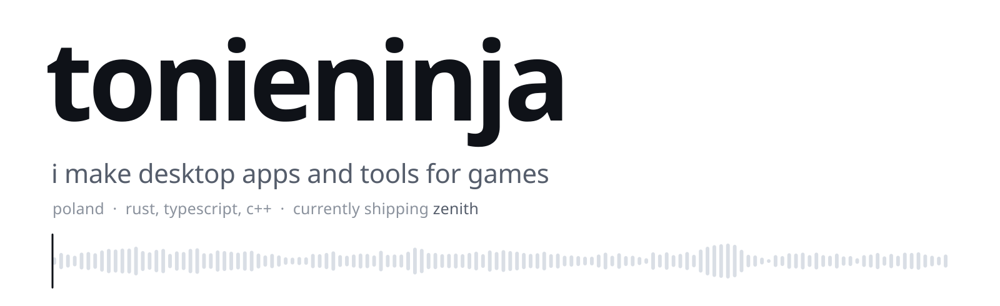
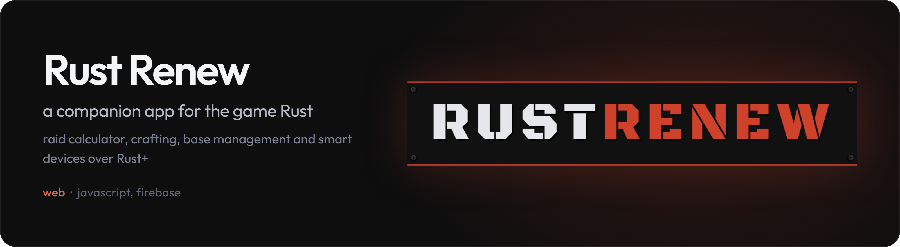
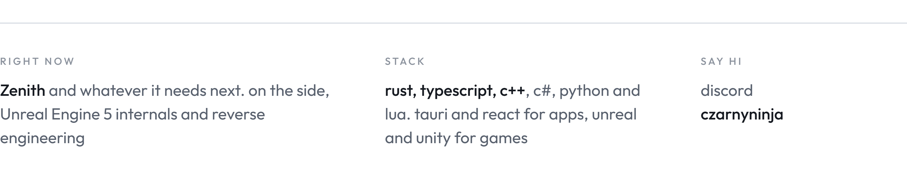

<picture>
  <source media="(prefers-color-scheme: dark)" srcset="assets/header-dark.svg">
  
</picture>

  <a href="https://github.com/tonieninja/zenith-player">source</a>
  &nbsp;·&nbsp;
  <a href="https://github.com/tonieninja/zenith-player/releases/latest">download</a>

<picture>
  <source media="(prefers-color-scheme: dark)" srcset="assets/footer-dark.png">
  
</picture>
